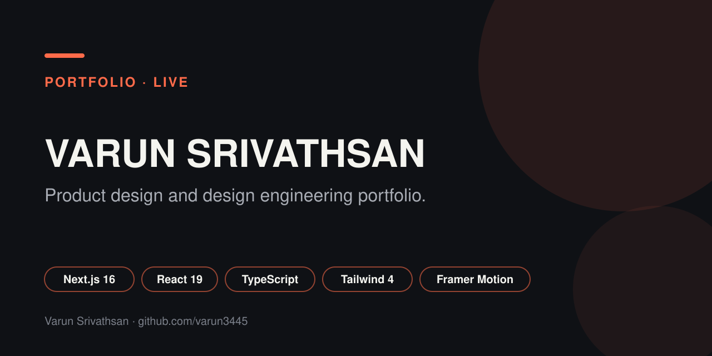

<p align="center"></p>

# Varun Srivathsan: Portfolio

The source for my product design and design engineering portfolio at [varunsrivathsan.com](https://varunsrivathsan.com).

   

## What is in it

A showcase site with in depth case studies, each rendered from typed content blocks so every write up shares one structure.

| Case study | Focus |
| --- | --- |
| [IDXF Idea Forge](src/data/idxf-content.ts) | AI matched collaboration platform for creatives |
| [Kaapu AI](src/data/kaapu-content.ts) | Voice first health app for chronic illness |
| [BBMP micro mobility](src/data/bbmp-content.ts) | Driver and passenger interfaces for a Bengaluru vehicle |
| [Plateform](src/data/plateform-content.ts) | Community platform for the London Borough of Hounslow |
| [PupSpot AR](src/data/pupspot-content.ts) | AR and dog visual recognition app |

## How it is built

- **Next.js App Router** with React 19 and TypeScript.
- **Tailwind CSS 4** for styling.
- **Framer Motion** for transitions and **Lenis** for smooth scrolling.
- **Typed case study blocks** (`src/components/CaseStudyBlocks.tsx`) so content lives in `src/data` and layout stays consistent.
- Custom cursor and motion details built as small reusable components.

## Run it locally

```bash
npm install
npm run dev
```

Open http://localhost:3000.

## Related

- [`varun-portfolio-v2`](https://github.com/varun3445/varun-portfolio-v2) is the next iteration.

## Author

[Varun Srivathsan](https://varunsrivathsan.com), product designer and design engineer based in London.
